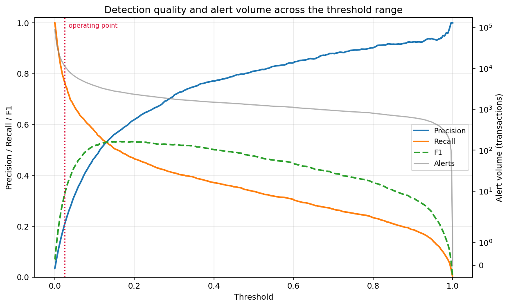
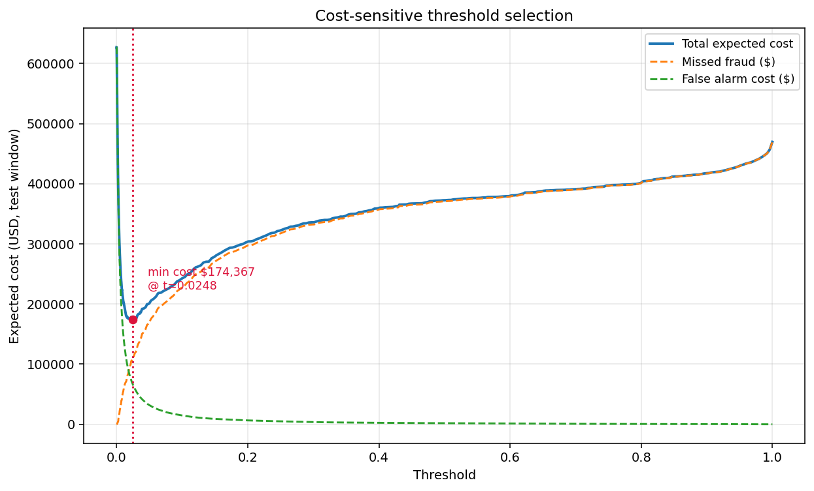
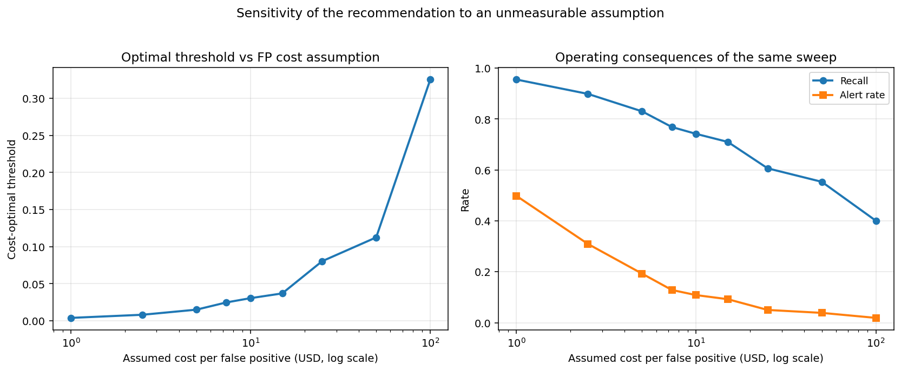
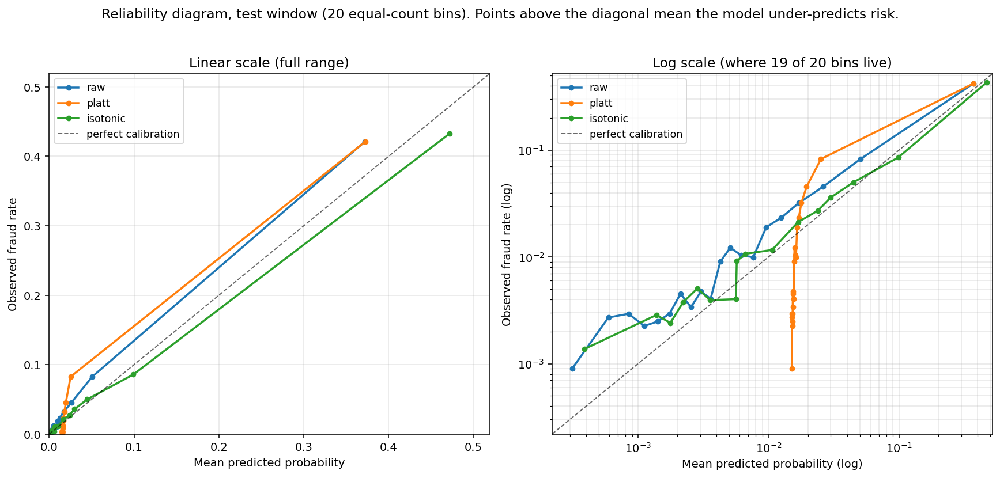
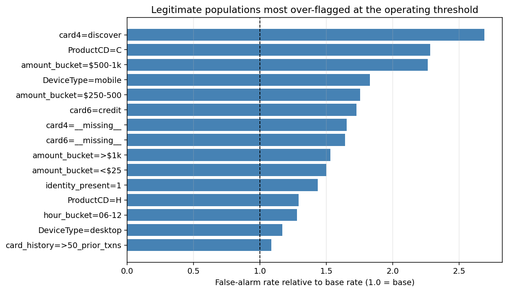

# fraud-threshold-lab

**Fraud detection threshold and false positive analysis harness**

A fraud model produces a score. A fraud review operation needs a decision, a
staffing plan, and an answer to "why did you flag my customer". This project is
about the layer in between: given a scored transaction stream, where do you set
the cutoff, what does that cost in analyst hours, how much fraud do you miss,
and which legitimate customers do you annoy in the process. The classifier here
is competent but ordinary. The threshold, cost, calibration, and false-positive
work sitting on top of it is the point.

Every number below comes from a single reproducible run on held-out data. The
unflattering ones are here too, and there are several.

---

## What the pipeline does, in order

1. **Load and join** IEEE-CIS transaction and identity tables (590,540 labelled
   transactions, 435 raw columns). Identity is a left join, not an inner join —
   it covers only 24.4% of rows and the missingness is signal, not noise.
2. **Time-aware split** on `TransactionDT` — 70% train / 15% validation / 15%
   test, in chronological order, with boundaries documented below.
3. **Feature engineering** across three families: transaction, device/identity,
   and behavioural aggregates fit on the training window only. 457 features.
4. **Leakage audit** — forbidden columns, target-derived columns, and aggregate
   provenance, all enforced in code and in tests.
5. **Models** — logistic regression baseline, then LightGBM, with three
   imbalance treatments compared head to head.
6. **Threshold sweep** — precision, recall, alert volume, analyst hours, and
   fraud dollars across the full operating range.
7. **Cost-sensitive selection** — asymmetric costs, optimal threshold, and a
   sensitivity sweep over the assumption that drives it.
8. **Calibration** — ECE, Brier, reliability curves, Platt and isotonic
   recalibration, compared at matched alert volume and at a fixed threshold.
9. **False positive characterization** — which legitimate behaviours get
   mistaken for fraud, as a structured artifact and as prose.

Single command: `make all`. Runtime **136 seconds** end to end on an M5 MacBook
Air, from raw CSV to every figure and table in this README.

---

## Data and split

| | |
|---|---|
| Transactions | 590,540 |
| Fraud | 20,663 (**3.499%**, 27.6:1 imbalance) |
| Time span | 182 days |
| Identity coverage | 24.4% (144,233 rows) |
| Fraud rate **with** identity | **7.85%** |
| Fraud rate **without** identity | **2.09%** |
| Columns >50% missing | 214 of 435 |
| Total fraud value | $3,083,845 (3.87% of $79.7M) |

Identity missingness is a 3.75x fraud-rate differential. That is why the join is
a left join: an inner join would have discarded 76% of the data *and* the signal
carried by the discard itself.

**Split boundaries** (chronological, no shuffling):

| Window | Rows | Days | Fraud rate | Fraud value |
|---|---|---|---|---|
| Train | 413,378 | 1.0 – 120.8 | 3.517% | $2,117,329 |
| Validation | 88,581 | 120.8 – 152.2 | 3.434% | $496,908 |
| Test | 88,581 | 152.2 – 183.0 | 3.480% | $469,609 |

The Kaggle competition test file has no public labels, so the evaluation split is
carved out of the labelled file along the time axis rather than using it.

---

## Results

### Discrimination (test window)

| Model | ROC AUC | PR AUC | PR AUC lift over base rate |
|---|---|---|---|
| Logistic regression baseline | 0.8497 | 0.3752 | 10.8x |
| **LightGBM (no reweighting)** | **0.9097** | **0.5524** | **15.9x** |
| LightGBM + `scale_pos_weight` | 0.8324 | 0.2740 | 7.9x |
| LightGBM + undersampling (3:1) | 0.9147 | 0.5329 | 15.3x |

No-skill PR AUC baseline is 0.0348, the test positive rate.

**PR AUC is the honest metric here and ROC AUC is not.** At a 3.5% positive
rate, the ROC curve's false-positive-rate axis is normalised by the 96.5%
negative class, so tens of thousands of false alarms barely move it. The model
posts a comfortable 0.9097 ROC AUC while, at its recommended operating point,
**79% of its alerts are wrong**. Precision-recall exposes that; ROC hides it.

### Negative result: the standard imbalance remedy made things worse

`scale_pos_weight=27.4` — the textbook fix, set to the class ratio — was the
worst of the three treatments by a wide margin, cutting validation PR AUC from
0.634 to 0.287. Undersampling at 3:1 was close to but still below doing nothing
(0.600 vs 0.634) while discarding 86% of the training rows.

Plain LightGBM with no imbalance handling at all won, selected on validation and
only then read off on test. The mechanism is that reweighting distorts the
predicted probabilities, and every downstream artifact in this project —
threshold selection, cost optimisation, calibration — depends on the score being
a usable probability rather than just a ranking. Reported because it is the
opposite of the default advice.

### Threshold sweep — the operational table

What it costs to hit a given recall target on the test window (88,581
transactions, 30 days, $469,609 of fraud), at 4 minutes per manual review:

| Recall target | Threshold | Alerts | Analyst hours | Precision | False alarm rate | Fraud $ caught | Fraud $ missed |
|---|---|---|---|---|---|---|---|
| 50% | 0.1566 | 2,716 | 181 | 56.8% | 43.2% | $194,603 | $275,006 |
| 60% | 0.0851 | 4,269 | 285 | 43.3% | 56.7% | $257,379 | $212,230 |
| 70% | 0.0369 | 8,183 | 546 | 26.8% | 73.2% | $327,586 | $142,023 |
| 80% | 0.0182 | 14,586 | 972 | 17.0% | 83.0% | $382,320 | $87,289 |
| 90% | 0.0078 | 28,460 | **1,897** | 9.8% | 90.2% | $429,360 | $40,249 |

The shape of that table is the whole argument. Going from 50% to 90% recall
recovers an additional $234,757 of fraud and costs an additional 1,716 analyst
hours — roughly ten full-time analysts for the month, to catch fraud at a
marginal rate of about $137 recovered per analyst hour. Whether that trade is
worth making is a staffing decision, not a modelling one, and this is the table
that lets someone make it.



### Cost-sensitive threshold vs F1-optimal threshold

Cost model: a missed fraud costs its **actual transaction amount**; a false alarm
costs **$7.33** ($2.33 of analyst time at $35/hr × 4 min, plus a $5 customer
friction proxy).

| | Cost-optimal | F1-optimal |
|---|---|---|
| Threshold | **0.0248** | 0.1647 |
| Alerts | 11,384 | 2,642 |
| Analyst hours | 759 | 176 |
| Recall | 76.8% | 49.5% |
| Precision | 20.8% | 57.8% |
| Fraud $ missed | $108,257 | $280,657 |
| False alarm cost | $66,110 | $8,184 |
| **Total expected cost** | **$174,367** | $288,841 |

**Optimising F1 instead of cost costs $114,474 on a single 30-day window** — a
66% cost increase. F1 treats a missed fraud and a false alarm as equally
regrettable; at these amounts a missed fraud averages roughly 20x the cost of a
false alarm, so the symmetric metric sets the bar far too high. The cost-optimal
point buys 27 percentage points of recall for 583 extra analyst hours.



### Sensitivity — how much should you trust that recommendation?

The $5 friction figure is an assumption nobody can measure. Sweeping the
false-positive cost across two orders of magnitude:

| Cost per FP | Threshold | Alerts | Analyst hours | Recall |
|---|---|---|---|---|
| $1.00 | 0.0039 | 44,113 | 2,941 | 95.5% |
| $2.50 | 0.0082 | 27,393 | 1,826 | 89.8% |
| $5.00 | 0.0150 | 17,076 | 1,138 | 83.0% |
| **$7.33** | **0.0248** | **11,384** | **759** | **76.8%** |
| $10.00 | 0.0306 | 9,606 | 640 | 74.1% |
| $25.00 | 0.0803 | 4,442 | 296 | 60.6% |
| $100.00 | 0.3253 | 1,682 | 112 | 40.1% |

**The recommendation is not stable, and that is the finding.** A 100x swing in
the false-positive cost moves the threshold 83x and swings required staffing from
2,941 hours to 112 — a factor of 26. Recall ranges from 95.5% to 40.1%.

The practical consequence is that this assumption deserves real measurement
rather than a guess. Narrowing it to the $5–$10 band still spans 640 to 1,138
analyst hours, so even a rough empirical estimate of customer friction cost
would meaningfully tighten the staffing plan. Presenting a single "optimal
threshold" without this sweep would imply a precision the analysis does not have.



### Calibration

| | ECE (quantile bins) | ECE (uniform bins) | Brier | Mean predicted | Observed |
|---|---|---|---|---|---|
| Raw LightGBM | 0.00837 | 0.00924 | 0.02196 | 0.0264 | 0.0348 |
| Platt scaling | 0.01495 | 0.00542 | 0.02306 | 0.0343 | 0.0348 |
| **Isotonic** | **0.00443** | **0.00428** | **0.02179** | 0.0355 | 0.0348 |

Recalibrators are fit on validation and evaluated on test.

**Isotonic regression roughly halves ECE. Platt scaling made it worse** under
quantile binning (0.00837 → 0.01495) while improving it under uniform binning.
Reported both ways rather than picking the flattering one.

The two-panel reliability diagram shows why, and the mechanism is worth stating
precisely. Across the bottom 16 of 20 equal-count bins — 80% of the test window
— the observed fraud rate genuinely varies **26-fold**, from 0.09% to 2.33%.
Over that same range Platt's predictions span a factor of **1.1**, from 0.0151
to 0.0171: the sigmoid collapses almost the entire score distribution onto a
single value. Raw scores preserve a 40x spread there and isotonic preserves
1,219x. Platt fixes the *aggregate* bias (mean prediction moves from 0.0264 to
0.0343 against an observed 0.0348, which is why uniform-bin ECE improves) while
destroying the *resolution* that a threshold needs. For a system whose entire
purpose is choosing a cutoff, that trade is a bad one, and it is invisible if
you look only at a single ECE number.

**Two findings that contradict the usual story:**

*First, the model is under-confident, not over-confident.* It predicts a mean
fraud probability of 0.0264 against an observed 0.0348 — it understates risk by
about 24%. The standard warning is that an overconfident model inflates false
positives at a fixed threshold. Here the bias runs the other way, so
recalibration *raises* scores and **increases** alert volume at a fixed cutoff:
at threshold 0.5, Platt-calibrated scores raise 1,470 alerts against the raw
model's 1,282, adding 89 false positives (and catching 99 more frauds).

*Second, at matched alert volume calibration changes nothing, by construction.*

| At 11,384 alerts | False positives | Precision | Recall |
|---|---|---|---|
| Raw | 9,015 | 20.81% | 76.84% |
| Platt | 9,015 | 20.81% | 76.84% |
| Isotonic | 9,022 | 20.75% | 76.61% |

Platt scaling is strictly monotone, so it cannot reorder the queue; hold alert
volume fixed and you are reviewing the identical 11,384 transactions, so the
false-positive count is *necessarily* identical. Isotonic is only weakly
monotone — it flattens ties — and came out 7 false positives *worse*.

So: **calibration did not reduce false positives at fixed alert volume, and it
could not have.** It still matters, for a different reason than the one usually
given. A calibrated score can be read as a probability, which is what makes the
expected-cost calculation above meaningful — you cannot multiply an uncalibrated
score by a dollar amount and get an expected loss. Calibration buys correctness
of the *cost model*, not fewer false positives at fixed capacity.



### False positive characterization

At the cost-optimal threshold the model raises 11,384 alerts, of which **9,015
are false alarms (79.2% of all alerts)**. Against 85,498 legitimate transactions
that is a 10.5% base false-alarm rate — roughly one in ten genuine customers in
this window gets flagged.

Legitimate populations flagged well above base rate:

| Attribute | Value | Legit txns | False alarms | Rate | **Lift** |
|---|---|---|---|---|---|
| `card4` | discover | 846 | 240 | 28.4% | **2.69x** |
| `ProductCD` | C | 8,118 | 1,952 | 24.1% | **2.28x** |
| `amount_bucket` | $500–1k | 2,280 | 544 | 23.9% | **2.26x** |
| `DeviceType` | mobile | 6,790 | 1,309 | 19.3% | **1.83x** |
| `amount_bucket` | $250–500 | 5,523 | 1,021 | 18.5% | **1.75x** |
| `card6` | credit | 19,461 | 3,541 | 18.2% | **1.73x** |

And the recurring joint profiles, from k-means over the false alarms:

- **Cluster 3 — 4,065 false alarms (45.1%).** Mid-value evening purchases:
  $100–250 (1.5x over-represented), 18:00–24:00 (1.4x). The largest single
  bucket and the least distinctive — ordinary evening retail.
- **Cluster 0 — 1,932 false alarms (21.4%).** Small mobile purchases on
  ProductCD `C`: product C 8.6x over-represented, mobile 5.3x, under $25 5.9x,
  identity present 4.1x. Median $29.76 against a legitimate median of $68.53.
- **Cluster 2 — 1,382 false alarms (15.3%).** Overnight transactions:
  00:00–06:00 4.1x over-represented. Timing alone is driving these.
- **Cluster 4 — 1,177 false alarms (13.1%).** Established cards with >50 prior
  transactions. These are the most damaging commercially — known-good repeat
  customers.
- **Cluster 1 — 459 false alarms (5.1%).** High-value credit purchases:
  $500–1k **20.5x** over-represented, median $994. Smallest cluster, highest
  friction per incident.

The actionable read for a modelling team: **the model is over-weighting amount
band and time-of-day**. Clusters 1, 2 and 3 — 5,906 false alarms, 65% of the
total — are separated from legitimate traffic mainly by *when* the transaction
happened and *how much* it was for, not by anything behavioural. That is a
feature-engineering target, not a threshold problem.

Machine-readable artifacts: [`false_positive_segments.csv`](artifacts/tables/false_positive_segments.csv),
[`false_positive_clusters.csv`](artifacts/tables/false_positive_clusters.csv).



---

## Design decisions

**Time-aware split, not random.** Fraud is temporal and cards recur. A random
split lets the model see a card's later behaviour while scoring its earlier
transactions, which inflates every metric. The three windows here are contiguous
and disjoint in time, and the invariant is asserted in code
([`leakage.py`](src/ftlab/leakage.py)), not just intended.

**Aggregates carry provenance.** Per-card and per-address statistics are the
strongest features available and the easiest place to leak. `AggregateMaps`
stores the index it was fit from, and `build_features` refuses to run if that
index extends beyond the training window. There is a test that constructs the
realistic mistake — fitting card statistics before splitting — and asserts it
raises.

**Cards unseen in training get NaN, not an imputed mean.** A card first observed
in the test period genuinely has no history. Telling the model that is more
honest than handing it a population average, and LightGBM routes missing values
down their own branch.

**Winsorizing the linear baseline at ±5σ.** Several anonymised `V*` columns reach
500 standard deviations after scaling, and an unclipped linear model spends its
capacity on those tails: clipping lifted baseline PR AUC from 0.164 to 0.375.
Trees are scale-invariant, so this is applied only in the logistic pipeline.
Without it the baseline would have looked far weaker than it is and overstated
how much the gradient-boosted model beats it by.

**Amount is a feature and also the cost of a miss.** `TransactionAmt` is known at
authorisation time, so it is a legitimate input; it separately serves as the
false-negative cost. That is not leakage, and the leakage guard explicitly
exempts it with a comment saying why.

**The false-alarm denominator is legitimate transactions only.** The question a
review manager asks is what share of genuine customers get bothered, not what
share of all traffic.

---

## Limitations

State these plainly; they bound what the numbers above mean.

1. **The logistic baseline never converged.** LBFGS hits its 1,000-iteration cap
   without reaching its gradient tolerance, and it does not converge at 3,000 or
   5,000 iterations either, nor at regularisation strengths from C=1.0 down to
   C=0.01. Predictions are stable regardless — PR AUC moves from 0.375 to 0.390
   between a 1k and a 3k budget, 4% for triple the compute — so the baseline is
   usable, but it is a non-converged baseline and the run reports
   `"converged": false` rather than hiding it.

2. **IEEE-CIS labels are chargeback-reported fraud, not ground truth.** The
   competition documentation notes that when a card is reported fraudulent, later
   transactions on that account are labelled fraud as well. Some positives are
   therefore inferred rather than confirmed, and undetected fraud sits in the
   negative class. Real recall is lower than reported recall.

3. **A single 30-day test window.** All operational numbers come from one
   contiguous period. No seasonality, no fraud-pattern drift across quarters, no
   confidence intervals from repeated splits. A different month would give
   different dollar figures.

4. **The false-positive cost is invented.** $5 of customer friction is a
   placeholder. As the sensitivity table shows, this assumption dominates the
   recommendation, and the honest output of this project is the sweep, not the
   single threshold.

5. **Analyst review is modelled as a constant 4 minutes.** Real handling time
   varies by case complexity and is probably correlated with score. Review
   capacity is also treated as perfectly fungible, with no queueing, shift
   structure, or fatigue.

6. **Features are anonymised.** The `V*`, `C*` and `D*` blocks have no published
   meaning, which caps how specific the false-positive feedback can be. The
   characterization deliberately uses only interpretable columns for that reason
   — "V257 is elevated" is not a finding anyone can act on.

7. **No hyperparameter search.** LightGBM runs at fixed, modest settings. The
   operational layer is the contribution; a tuned model would shift the absolute
   numbers but not the structure of any conclusion here.

8. **Not a production system.** No serving path, no monitoring, no retraining
   loop, no drift detection. This is a portfolio analysis harness.

---

## Reproducing

Requires Python 3.11+, a Kaggle API token at `~/.kaggle/kaggle.json`, and
acceptance of the [IEEE-CIS competition rules](https://www.kaggle.com/c/ieee-fraud-detection/rules)
(the API returns 403 until those are accepted).

```bash
make all
```

That runs `setup` (uv venv + pinned deps), `data` (downloads the two training
tables, ~710 MB), `run` (the full pipeline, ~136 s), and `test`.

Individual steps:

```bash
make data     # download IEEE-CIS training tables
make profile  # data profile + split boundaries only
make run      # full pipeline -> artifacts/
make test     # 93 tests
```

Outputs land in `artifacts/tables/` (CSV + `run_results.json` containing every
number in this README), `artifacts/figures/`, and
`artifacts/false_positive_profile.md`.

**Reproducibility:** dependencies are pinned in `pyproject.toml`, the seed is
fixed at `config.RANDOM_SEED`, and `run_results.json` records the full parameter
set alongside the results. Re-running reproduces the reported numbers exactly.

### Testing

93 tests, run on Python 3.11 and 3.12 in CI. They deliberately use synthetic
fixtures rather than the Kaggle data — that data is not redistributable, and the
logic worth guarding is the metric, threshold, cost, and leakage code, none of
which needs the real dataset. Tests concentrate on the parts a reviewer would
question:

- confusion counts and dollar totals checked against hand-computed values
- monotonicity invariants (recall and alert volume decrease with threshold;
  raising false-positive cost never lowers the optimal threshold)
- boundary ties landing on the same side of the cutoff
- the cost-optimal point genuinely minimising cost, and never losing to the
  F1 point on cost
- each leakage check demonstrated firing on a leak it is meant to catch
- Platt monotonicity, asserted so the matched-volume result cannot silently change

---

## Project layout

```
src/ftlab/
  config.py       cost assumptions, split fractions, seeds
  data.py         load, join, profile
  split.py        time-aware split
  leakage.py      the guard, with provenance checking
  features.py     three feature families + aggregate provenance
  models.py       logistic baseline, LightGBM, imbalance comparison
  threshold.py    the sweep and the operational table
  cost.py         cost-sensitive selection and sensitivity
  calibration.py  ECE, reliability, Platt, isotonic
  fpanalysis.py   false-positive segmentation and prose generation
  plots.py        figures
scripts/
  download_data.py, profile_data.py, run_pipeline.py
tests/            93 tests, synthetic fixtures only
```

## Data source

[IEEE-CIS Fraud Detection](https://www.kaggle.com/c/ieee-fraud-detection),
Vesta Corporation via Kaggle. Not redistributed here — `make data` fetches it
with your own credentials.
